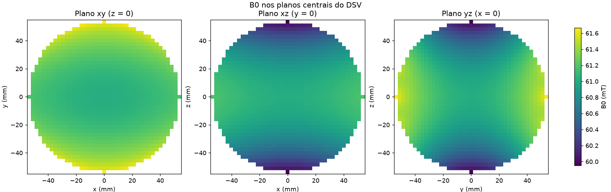

# Análise de viabilidade do ímã Halbach para RM portátil de 50 mT

**Iniciação Científica — Engenharia de Computação, UTFPR**  
**Aluno:** João Vitor Cabeça · **Orientador:** Marcelo Antonassi · **Data:** outubro de 2026

---

## 1. Objetivo

Verificar se é viável construir um ímã permanente em arranjo Halbach que
produza **50 mT** com **boa homogeneidade**, respeitando limites de tamanho e
massa, em dois cenários:

| Cenário | Região útil (DSV) | Bore mínimo | Massa máxima de ímãs |
|---|---|---|---|
| **Cabeça** | esfera de 200 mm | Ø 270 mm | 40 kg |
| **Membros** | esfera de 110 mm | Ø 150 mm | 20 kg |

Requisitos comuns: campo de **50 ± 1 mT** no centro, campo **vertical**
(perpendicular ao eixo do bore) e comprimento do ímã entre **54 e 76 cm**.
A **homogeneidade é o objetivo**: quanto mais perto de 100 %, melhor.

> Homogeneidade (%) = 100 % − (B_máx − B_mín)/B0 × 100.  
> Conversão: 10 000 ppm = 99 % · 1 000 ppm = 99,9 % · 100 ppm = 99,99 %.

---

## 2. Método

### 2.1 Arranjo simulado

O ímã é formado por anéis de cubos de NdFeB (12 mm, Br = 1,3 T) ao longo do
eixo z. Em cada anel, a magnetização gira ao redor do círculo no padrão
Halbach k = 2, o que gera um campo transversal uniforme no centro.

**Na análise de viabilidade, todos os anéis de um arranjo são iguais** (mesmo
raio, mesmo número de camadas), igualmente espaçados. Partindo de uma
configuração de referência, um parâmetro (gráficos de linha) ou dois
parâmetros (mapas de calor) são variados e os demais ficam fixos. Assim o
efeito de cada escolha de projeto aparece isolado.

Parâmetros analisados:

| Parâmetro | Faixa (cabeça) | Faixa (membros) |
|---|---|---|
| Número de anéis | 1 – 61 | 1 – 49 |
| Raio livre interno (bore) | 100 – 220 mm | 60 – 160 mm |
| Camadas de ímãs por anel | 1, 2, 3 | 1, 2 |
| Espaçamento entre anéis | 13 – 40 mm | 13 – 40 mm |
| Aresta do cubo | 6 – 20 mm | 6 – 20 mm |
| Remanência Br | 1,10 – 1,45 T | 1,10 – 1,45 T |
| Diâmetro do DSV | 40 – 260 mm | 20 – 150 mm |

Foram simulados **1 914 arranjos para a cabeça** e **1 331 para os membros**.

### 2.2 Cálculo do campo

- **Modelo de campo:** expressão analítica exata do campo de um cubo
  uniformemente magnetizado (biblioteca *magpylib*), com a orientação de cada
  ímã. Numa etapa anterior mostrei que a aproximação de dipolo pontual erra
  cerca de 0,25·(a/r)⁴, o que chega a ~3,7 % na homogeneidade do cenário de
  membros. Por isso usei o modelo exato.
- **Geometria verificada:** o número de ímãs por anel é calculado para que os
  cubos não se sobreponham. Arranjos fisicamente impossíveis são descartados.
- **Medida da homogeneidade:** dentro do DSV não há ímãs, então cada
  componente do campo é uma função harmônica (∇²B = 0). Disso decorre que:

    - o **máximo e o mínimo** do campo na esfera ficam **na superfície**
      (princípio do máximo);
    - a **média** do campo no volume é igual ao **valor no centro**
      (propriedade da média).

  A homogeneidade é calculada com pontos só na superfície do DSV. O método foi
  validado contra uma grade 3D completa: diferença de 6×10⁻⁶ no campo e menor
  que 0,5 ppm na homogeneidade.

### 2.3 Configuração de referência

Para escolher a referência, testei ~90 mil combinações de número de anéis,
espaçamento, bore e camadas, e escolhi a **mais homogênea que atende a todos
os requisitos**:

| | Cabeça | Membros |
|---|---|---|
| Número de anéis | 47 | 35 |
| Espaçamento | 16 mm | 22 mm |
| Bore (diâmetro livre) | 280 mm | 200 mm |
| Camadas por anel | 1 | 1 |
| Cubo / Br | 12 mm / 1,3 T | 12 mm / 1,3 T |

---

## 3. Resultados

### 3.1 Número de anéis — o fator mais importante para a homogeneidade

- Mais anéis deixam o cilindro mais comprido e **afastam as pontas do DSV**.
  As pontas são a principal fonte de inomogeneidade.
- O campo cresce e **satura**. Na cabeça, com 1 camada, ele chega aos 50 mT
  com ~39 anéis (espaçamento de 16 mm).
- A homogeneidade melhora continuamente: na cabeça chega a 99,83 % com 61
  anéis. A massa cresce linearmente.

### 3.2 Camadas de ímãs — uma camada é suficiente

- Cada camada extra aumenta bastante o campo, mas **não melhora a
  homogeneidade** e aumenta muito a massa.
- Com **1 camada** os 50 mT já são alcançados nos dois cenários. Com 2 ou 3
  camadas o campo passa muito do alvo: na cabeça, com 61 anéis, chega a
  94,7 mT com 2 camadas e 133,9 mT com 3.

### 3.3 Raio do anel (bore)

- O campo **cai** quando o raio aumenta: cada ímã fica mais longe do centro,
  mesmo cabendo mais ímãs por anel.
- Com 1 camada, os 50 mT aparecem com bore de **~282 mm de diâmetro na
  cabeça** e **~199 mm nos membros**. Os dois são compatíveis com os bores
  mínimos (270 e 150 mm).

### 3.4 Espaçamento entre anéis — compromisso entre campo e homogeneidade

- Espaçar mais os anéis deixa o ímã mais longo, o que **melhora a
  homogeneidade**, mas dilui o material, e **o campo cai**.
- No mapa, a linha branca (50 mT) e as linhas azuis (54 e 76 cm) mostram que
  a **região viável é estreita** (verde): o campo alvo e o limite de
  comprimento praticamente fixam o espaçamento em **~16 mm na cabeça** e
  **~22 mm nos membros**.
- Só **2 a 5 %** dos arranjos de cada mapa ficam dentro de 50 ± 1 mT.

### 3.5 Tamanho do cubo e remanência

- O campo cresce rápido com a aresta do cubo. Com 1 camada, o cubo de
  **12 mm** dá exatamente os 50 mT nos dois cenários. O tamanho do cubo quase
  não afeta a homogeneidade.
- O campo é **proporcional a Br**, e a homogeneidade **não muda** com Br.
  Os 50 mT exigem Br ≈ 1,3 T (NdFeB N42). Isso também serve de verificação do
  modelo.

### 3.6 Tamanho do DSV

A homogeneidade piora muito rapidamente com o tamanho da região útil:

| Ímã de referência | DSV pequeno | DSV do projeto |
|---|---|---|
| Cabeça (47 anéis) | 99,973 % em 40 mm | 99,29 % em 200 mm |
| Membros (35 anéis) | 99,998 % em 20 mm | 99,93 % em 110 mm |

Por isso o cenário de membros é bem mais fácil: o DSV é pequeno em relação
ao bore.

### 3.7 Massa × homogeneidade

Cada ponto é um arranjo simulado. A borda inferior da nuvem é o melhor
compromisso possível entre massa e homogeneidade com anéis iguais.

---

## 4. Arranjos viáveis

| | **Cabeça** | **Membros** |
|---|---|---|
| Arranjo | 47 anéis, 1 camada, espaç. 16 mm, bore Ø280 mm | 35 anéis, 1 camada, espaç. 22 mm, bore Ø200 mm |
| Campo B0 | **50,3 mT** | **49,6 mT** |
| **Homogeneidade** | **99,29 %** (7 098 ppm) | **99,93 %** (685 ppm) |
| Massa de ímãs | 30,5 kg | 16,3 kg |
| Número de ímãs | 2 350 | 1 260 |
| Comprimento | 74,8 cm | 76,0 cm |
| Diâmetro externo | 31,4 cm | 23,4 cm |
| Frequência de Larmor (¹H) | 2,14 MHz | 2,11 MHz |

### Campo B0 nos planos centrais do DSV — cabeça

Cor uniforme = campo homogêneo.

### Campo B0 nos planos centrais do DSV — membros

---

## 5. Conclusões

1. **Os dois cenários são viáveis** dentro dos requisitos de campo, bore,
   massa e comprimento.
2. **O padrão ótimo é o mesmo nos dois:** um ímã **longo** (perto do limite
   de 76 cm) com **uma camada** de ímãs. O comprimento afasta as pontas do
   DSV, e uma camada basta para os 50 mT, deixando margem de massa para mais
   anéis.
3. **O número de anéis (comprimento) é o parâmetro que mais influencia a
   homogeneidade.** Raio, tamanho do cubo, camadas e Br servem
   principalmente para ajustar o campo em 50 mT.
4. **Membros:** 99,93 % de homogeneidade já com anéis iguais.
5. **Cabeça:** com anéis iguais a homogeneidade fica limitada a ~99,3 %. Para
   chegar mais perto de 100 % é preciso **variar o raio de cada anel**. Num
   teste anterior, otimizando os raios com algoritmo genético, um ímã de
   ~50 cm chegou a ~99,92 %.

---

## 6. Limitações

- A massa considera **só os ímãs**: não inclui estrutura de suporte, bobinas
  nem blindagem.
- Os ímãs foram considerados **ideais**: Br igual em todas as peças e montagem
  perfeita. Na prática há variação de ~1–2 % em Br e erro de posicionamento,
  o que piora a homogeneidade (normalmente corrigido com *shimming*).
- O Br do NdFeB varia ~0,1 %/°C com a temperatura. Isso desloca o campo (e a
  frequência de operação), mas não altera a homogeneidade.

---

## 7. Próximos passos propostos

1. **Otimizar o raio de cada anel** dentro da faixa de 54–76 cm,
   principalmente para a cabeça.
2. **Avaliar o efeito das tolerâncias** reais dos ímãs (Br e posição) por
   simulação de Monte Carlo.
3. **Definir a homogeneidade mínima** necessária para a imagem, como critério
   de aprovação.
4. Projetar a **estrutura de suporte** e gerar o modelo 3D para fabricação.

---

### Material complementar

- Relatórios completos, com todos os gráficos e explicações:
  [cabeça](resultados/viabilidade/head/relatorio.md) ·
  [membros](resultados/viabilidade/limb/relatorio.md)
- Dados de todos os arranjos simulados (CSV): `resultados/viabilidade/*/dados/`
- Código e instruções: [analise_viabilidade.md](analise_viabilidade.md)
