# Análise de viabilidade — cenário `limb`

Gerado em 22/10/2026 15:44. 1331 arranjos simulados em 20 s (modelo de campo: `cuboid`).

Arquivos: figuras em `figuras/`, dados de todos os arranjos em `dados/` (CSV, abre no Excel).

**Sumário:** 1. O que é esta análise · 2. Configuração de referência · 3. Critérios de viabilidade · 4. Como ler os gráficos · 5. Gráficos de linha · 6. Mapas de calor · 7. Massa × homogeneidade · 8. Arranjos viáveis · 9. Limitações

## 1. O que é esta análise

Esta é uma **análise de viabilidade por varredura de parâmetros**. Não há
otimização: em cada arranjo simulado, **todos os anéis são iguais** (mesmo
raio, mesmo número de camadas, mesmo ímã), igualmente espaçados e centrados no
meio do ímã. Partindo de uma **configuração de referência**, um parâmetro
(gráficos de linha) ou dois parâmetros (mapas de calor) são variados, e os
demais ficam fixos. Assim dá para ver separadamente o efeito de cada escolha
de projeto.

**Como o campo é calculado.** Cada cubo de NdFeB é simulado com a expressão
analítica exata do campo de um cubo uniformemente magnetizado (biblioteca
magpylib), com a magnetização girando ao redor do anel no padrão Halbach
(k = 2), para gerar um campo transversal na direção vertical.

**Duas propriedades físicas tornam o cálculo exato e rápido.** Dentro do DSV
não há ímãs, então cada componente do campo é uma função harmônica
(∇²B = 0). Disso decorre que:

* o **maior e o menor valor do campo dentro da esfera ficam na superfície**
  (princípio do máximo). A inomogeneidade do volume inteiro é medida com
  pontos só na superfície do DSV;
* a **média do campo no volume é igual ao campo no centro** (propriedade da
  média). Por isso o "campo do ímã" é B0 no centro.

Os dois resultados foram conferidos contra o cálculo numa grade 3D completa
(diferença de 6×10⁻⁶ no campo e < 0,5 ppm na inomogeneidade).

**Importante — os valores absolutos de homogeneidade são pessimistas.** Com
anéis todos iguais, a homogeneidade fica na casa de dezenas de milhares de
ppm. Escolhendo um raio diferente para cada anel (otimização, feita na branch
`main` deste repositório), o mesmo tipo de arranjo chega a algumas centenas
de ppm. Por isso esta análise serve para comparar **tendências** (o que
melhora e o que piora cada parâmetro) e para dimensionar campo, massa e
tamanho. O valor final de homogeneidade depende da otimização.

## 2. Configuração de referência

Todos os gráficos partem deste arranjo e mudam um ou dois parâmetros de cada vez.

| Parâmetro | Valor |
|---|---|
| Número de anéis | 35 |
| Espaçamento entre anéis | 22 mm |
| Raio livre interno (bore) | 100 mm |
| Camadas de ímãs por anel | 1 |
| Aresta do cubo | 12 mm |
| Remanência Br | 1,3 T |
| Diâmetro do DSV | 110 mm |

| Resultado | Valor |
|---|---|
| Campo B0 no centro | 49,61 mT |
| Inomogeneidade no DSV | 685 ppm |
| Homogeneidade | 99,93 % |
| Massa dos ímãs | 16,33 kg |
| Número de ímãs | 1 260  |
| Comprimento | 760 mm |
| Diâmetro externo | 234 mm |
| Campo por massa | 3,04 mT/kg |
| Frequência de Larmor (¹H) | 2,11 MHz |

### Campo da configuração de referência

**O que mostra:** o campo B0 nos três planos centrais do DSV, na mesma escala de cor. **Como ler:** cor uniforme = campo homogêneo. No plano xy (transversal) o campo de um Halbach é quase uniforme. Nos planos que contêm o eixo z (xz e yz) aparece a variação ao longo do comprimento, causada pelas pontas do cilindro. É ela que domina a inomogeneidade quando os anéis são todos iguais.

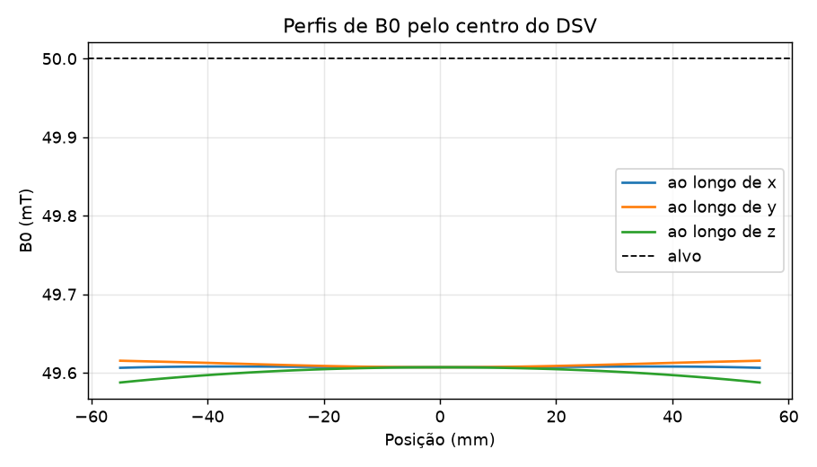

**O que mostra:** o campo ao longo de três retas que passam pelo centro (x, y e z). A linha tracejada é o alvo. Curvas planas = homogêneo. A curva de z mostra o efeito das pontas do cilindro.

## 3. Critérios de viabilidade

Um arranjo é **viável** quando atende a todos estes requisitos (valores do `config.toml`):

* campo no centro entre 49 e 51 mT;
* diâmetro livre (bore) de pelo menos 150 mm (espaço para bobinas de gradiente e RF);
* massa de ímãs de no máximo 20,0 kg;
* comprimento entre 54 e 76 cm;
* a **homogeneidade é o objetivo**, não um corte: entre os arranjos que atendem aos requisitos acima, o melhor é o mais próximo de 100 % (seção 8);
* geometria possível: os ímãs não se sobrepõem e o DSV cabe dentro do bore.

## 4. Como ler os gráficos

**Gráficos de linha** (seção 5). Cada figura tem quatro painéis que
compartilham o eixo horizontal (o parâmetro variado):

| Painel | O que mostra | O que é bom |
|---|---|---|
| Campo B0 no centro | campo produzido; faixa cinza = alvo ± tolerância | estar dentro da faixa cinza |
| Inomogeneidade no DSV | variação do campo dentro da esfera, em ppm, **escala log** (homogeneidade = 100 % − ppm/10 000) | quanto menor, melhor |
| Massa dos ímãs | massa de NdFeB; linha vermelha = limite | ficar abaixo da linha |
| Campo por massa | mT obtidos por kg de ímã | quanto maior, mais eficiente |

Cada curva é um valor de um segundo parâmetro (legenda). A linha
**pontilhada vertical** marca o valor da configuração de referência.

**Mapas de calor** (seção 6). Dois parâmetros variam juntos; cada célula é
um arranjo. Os quatro painéis são:

* **campo B0:** a **linha branca contínua** é o caminho dos arranjos que dão
  exatamente o campo alvo e as tracejadas, a tolerância. Qualquer ponto sobre
  a linha branca é um candidato;
* **inomogeneidade:** cores claras = melhor (mais perto de 100 % de
  homogeneidade); as linhas pretas marcam 1 000 ppm (99,9 %), 10 000 ppm
  (99 %), 100 000 ppm (90 %)...;
* **massa:** a linha vermelha é o limite de massa;
* **viabilidade:** verde = atende a todos os critérios. Nas outras cores, o
  nome do critério que falha (quando falham vários, aparece o mais grave).

A **estrela** marca a configuração de referência. As linhas **azuis
traço-ponto** marcam os limites de comprimento (quando o mapa os cruza): os
arranjos aceitáveis ficam entre elas.

Para achar um bom projeto num mapa: siga a linha branca do painel de campo e
procure, ao longo dela, a região mais clara no painel de inomogeneidade que
ainda esteja abaixo da linha vermelha de massa.

## 5. Gráficos de linha: um parâmetro de cada vez

### 5.1 Número de anéis (curvas: camadas de ímãs por anel)

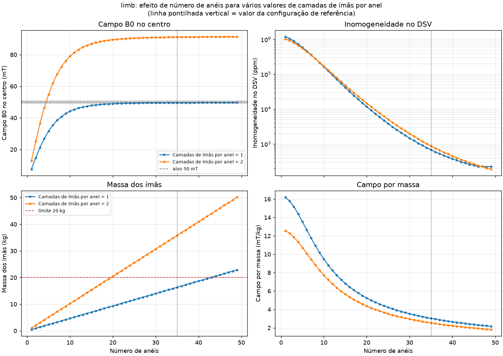

**O que varia:** número de anéis de 1 a 49; cada curva é um valor de camadas de ímãs por anel. O resto fica igual à referência.

**Por que acontece:** Mais anéis deixam o cilindro mais comprido. Um cilindro Halbach infinito tem campo perfeitamente uniforme; as imperfeições vêm principalmente das pontas. Com mais anéis as pontas se afastam do DSV: o campo no centro cresce até saturar e a homogeneidade melhora, mas a massa cresce linearmente.

**O que os números mostram:**

* **Camadas de ímãs por anel = 1:** B0 vai de 7,6 a 49,7 mT; fica sempre abaixo do alvo de 50 mT nesta faixa; a melhor homogeneidade é 99,978 % (221 ppm), com número de anéis = 48; massa de 0,5 a 22,9 kg.
* **Camadas de ímãs por anel = 2:** B0 vai de 12,9 a 91,3 mT; atinge o alvo de 50 mT em número de anéis ≈ 4; a melhor homogeneidade é 99,981 % (190 ppm), com número de anéis = 49; massa de 1,0 a 50,2 kg.

### 5.2 Raio livre interno (bore) (curvas: camadas de ímãs por anel)

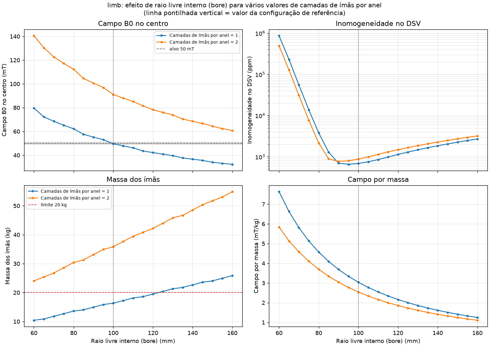

**O que varia:** raio livre interno (bore) de 60 mm a 160 mm; cada curva é um valor de camadas de ímãs por anel. O resto fica igual à referência.

**Por que acontece:** Um anel maior comporta mais ímãs (N cresce com o raio), mas cada ímã fica mais longe do centro e o campo de um dipolo cai com 1/r³. O saldo é um campo que cai aproximadamente com 1/r². Em compensação, o DSV fica relativamente menor dentro do anel, o que favorece a homogeneidade no plano transversal.

**O que os números mostram:**

* **Camadas de ímãs por anel = 1:** B0 vai de 32,3 a 79,7 mT; atinge o alvo de 50 mT em raio livre interno (bore) ≈ 99,4 mm; a melhor homogeneidade é 99,935 % (653 ppm), com raio livre interno (bore) = 95 mm; massa de 10,4 a 25,9 kg.
* **Camadas de ímãs por anel = 2:** B0 vai de 60,8 a 140,5 mT; fica sempre acima do alvo de 50 mT nesta faixa; a melhor homogeneidade é 99,923 % (771 ppm), com raio livre interno (bore) = 90 mm; massa de 24,0 a 54,9 kg.

### 5.3 Espaçamento entre anéis (curvas: número de anéis)

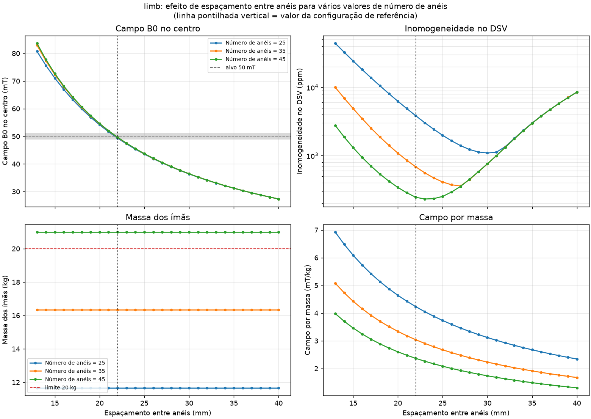

**O que varia:** espaçamento entre anéis de 13 mm a 40 mm; cada curva é um valor de número de anéis. O resto fica igual à referência.

**Por que acontece:** Com o número de anéis fixo, espaçar mais deixa o ímã mais comprido (pontas mais longe do DSV) mas dilui o material: há menos ímãs por metro, então o campo no centro cai. O espaçamento mínimo é a aresta do cubo mais a folga axial.

**O que os números mostram:**

* **Número de anéis = 25:** B0 vai de 27,3 a 80,8 mT; atinge o alvo de 50 mT em espaçamento entre anéis ≈ 21,7 mm; a melhor homogeneidade é 99,89 % (1 094 ppm), com espaçamento entre anéis = 30 mm; massa de 11,7 a 11,7 kg.
* **Número de anéis = 35:** B0 vai de 27,3 a 83,0 mT; atinge o alvo de 50 mT em espaçamento entre anéis ≈ 21,8 mm; a melhor homogeneidade é 99,964 % (360 ppm), com espaçamento entre anéis = 27 mm; massa de 16,3 a 16,3 kg.
* **Número de anéis = 45:** B0 vai de 27,3 a 83,6 mT; atinge o alvo de 50 mT em espaçamento entre anéis ≈ 21,9 mm; a melhor homogeneidade é 99,977 % (232 ppm), com espaçamento entre anéis = 23 mm; massa de 21,0 a 21,0 kg.

### 5.4 Aresta do cubo (curvas: camadas de ímãs por anel)

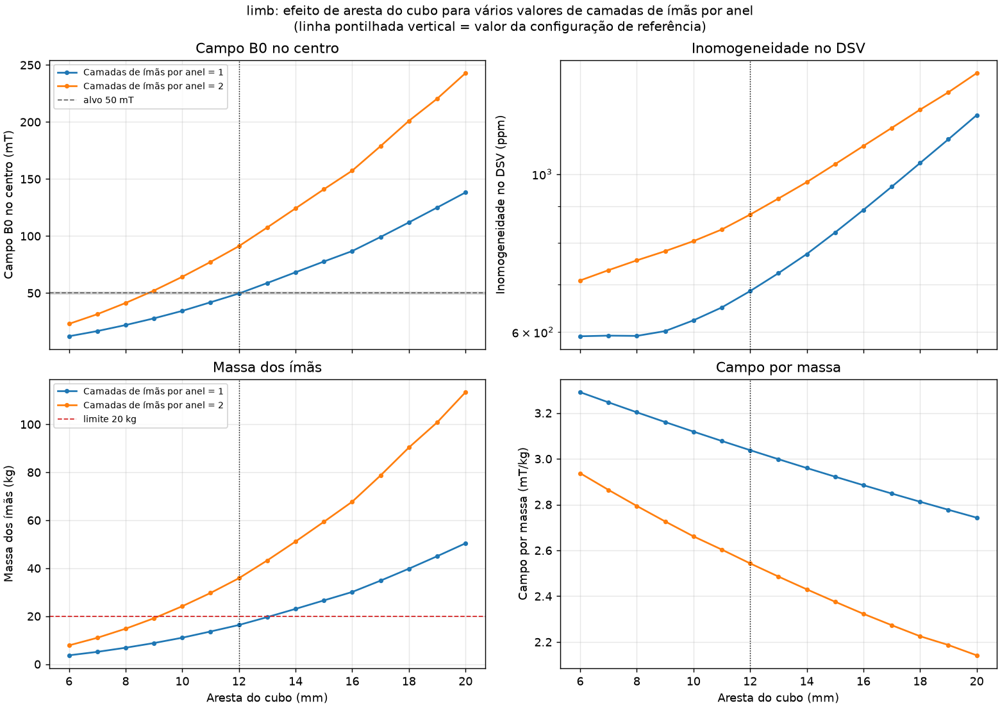

**O que varia:** aresta do cubo de 6 mm a 20 mm; cada curva é um valor de camadas de ímãs por anel. O resto fica igual à referência.

**Por que acontece:** Cubos maiores têm momento magnético proporcional a a³, mas cabem menos por anel (N ∝ 1/a). O campo cresce com o tamanho do ímã e a massa também. Cubos grandes também aumentam o erro do modelo de dipolo (ver DOCS/fase2_modelo_de_campo.md); aqui é usado o modelo configurado em viabilidade.toml.

**O que os números mostram:**

* **Camadas de ímãs por anel = 1:** B0 vai de 12,1 a 138,2 mT; atinge o alvo de 50 mT em aresta do cubo ≈ 12 mm; a melhor homogeneidade é 99,941 % (592 ppm), com aresta do cubo = 6 mm; massa de 3,7 a 50,4 kg.
* **Camadas de ímãs por anel = 2:** B0 vai de 23,0 a 242,9 mT; atinge o alvo de 50 mT em aresta do cubo ≈ 8,8 mm; a melhor homogeneidade é 99,929 % (709 ppm), com aresta do cubo = 6 mm; massa de 7,8 a 113,4 kg.

### 5.5 Remanência Br

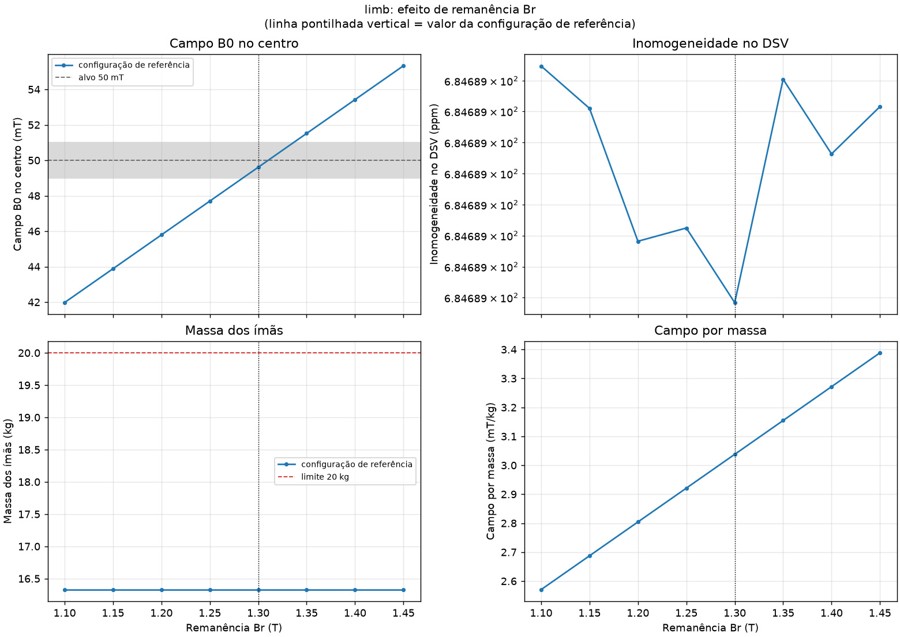

**O que varia:** remanência Br de 1,1 T a 1,45 T. O resto fica igual à referência.

**Por que acontece:** Br é a 'força' do material (N35 ≈ 1,18 T, N42 ≈ 1,30 T, N52 ≈ 1,44 T). O campo é diretamente proporcional a Br e a homogeneidade em ppm NÃO muda, porque ela depende só da geometria. Serve também como verificação do modelo.

**O que os números mostram:**

* **Configuração de referência:** B0 vai de 42,0 a 55,3 mT; atinge o alvo de 50 mT em remanência Br ≈ 1,31 T; a inomogeneidade não muda (685 ppm); massa de 16,3 a 16,3 kg.

### 5.6 Diâmetro do DSV (curvas: número de anéis)

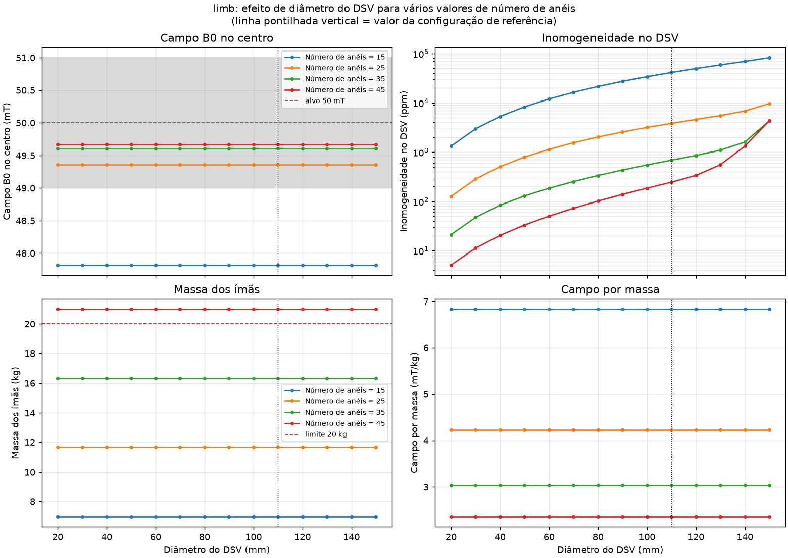

**O que varia:** diâmetro do DSV de 20 mm a 150 mm; cada curva é um valor de número de anéis. O resto fica igual à referência.

**Por que acontece:** O DSV é a região onde a imagem é feita. O ímã não muda; muda o tamanho da esfera onde a homogeneidade é medida. A inomogeneidade cresce rápido com o diâmetro (os termos de ordem n crescem com rⁿ), então este gráfico mostra até que tamanho de objeto o ímã é útil.

**O que os números mostram:**

* **Número de anéis = 15:** B0 vai de 47,8 a 47,8 mT; fica sempre abaixo do alvo de 50 mT nesta faixa; a melhor homogeneidade é 99,87 % (1 317 ppm), com diâmetro do DSV = 20 mm; massa de 7,0 a 7,0 kg.
* **Número de anéis = 25:** B0 vai de 49,4 a 49,4 mT; fica sempre abaixo do alvo de 50 mT nesta faixa; a melhor homogeneidade é 99,987 % (127 ppm), com diâmetro do DSV = 20 mm; massa de 11,7 a 11,7 kg.
* **Número de anéis = 35:** B0 vai de 49,6 a 49,6 mT; fica sempre abaixo do alvo de 50 mT nesta faixa; a melhor homogeneidade é 99,9979 % (21 ppm), com diâmetro do DSV = 20 mm; massa de 16,3 a 16,3 kg.
* **Número de anéis = 45:** B0 vai de 49,7 a 49,7 mT; fica sempre abaixo do alvo de 50 mT nesta faixa; a melhor homogeneidade é 99,9995 % (5 ppm), com diâmetro do DSV = 20 mm; massa de 21,0 a 21,0 kg.

## 6. Mapas de calor: dois parâmetros ao mesmo tempo

### 6.1 Número de anéis × Raio livre interno (bore)

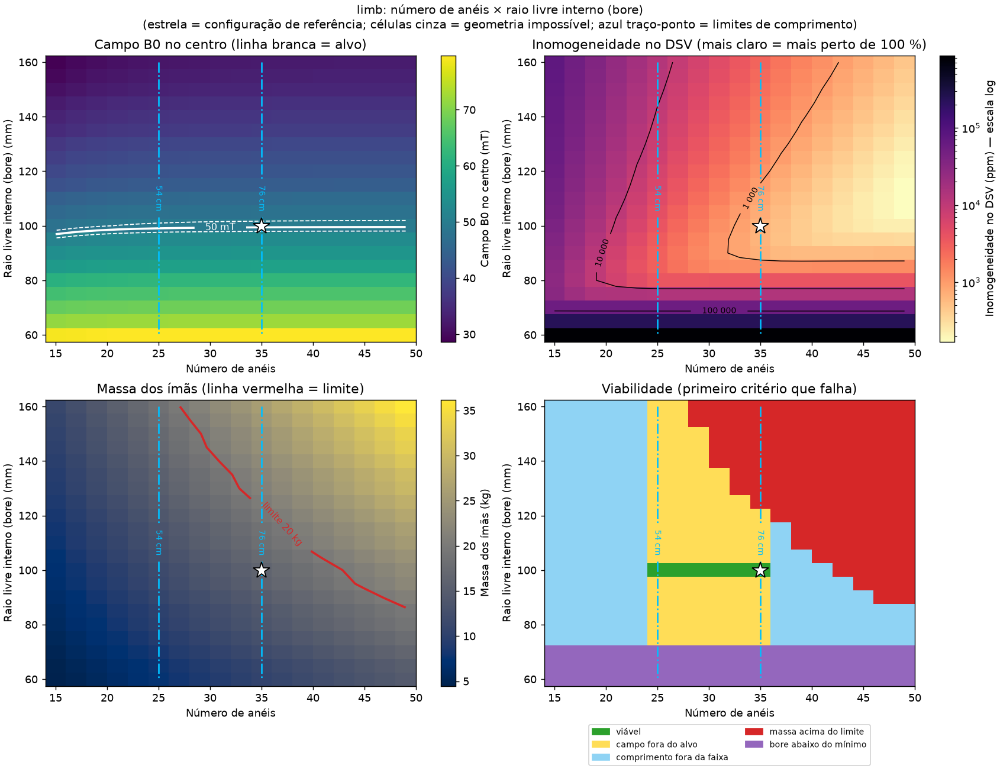

**O que varia:** número de anéis (eixo horizontal, 15 a 49) e raio livre interno (bore) (eixo vertical, 60 mm a 160 mm).

**Por que acontece:** *Número de anéis:* Mais anéis deixam o cilindro mais comprido. Um cilindro Halbach infinito tem campo perfeitamente uniforme; as imperfeições vêm principalmente das pontas. Com mais anéis as pontas se afastam do DSV: o campo no centro cresce até saturar e a homogeneidade melhora, mas a massa cresce linearmente. *Raio livre interno (bore):* Um anel maior comporta mais ímãs (N cresce com o raio), mas cada ímã fica mais longe do centro e o campo de um dipolo cai com 1/r³. O saldo é um campo que cai aproximadamente com 1/r². Em compensação, o DSV fica relativamente menor dentro do anel, o que favorece a homogeneidade no plano transversal.

**O que os números mostram:**

* O campo no centro varia de 28,7 a 79,7 mT no plano analisado.
* 15 de 378 arranjos (4,0 %) ficam dentro de 50 ± 1 mT.
* Melhor homogeneidade do mapa: 99,983 % (169 ppm), com número de anéis = 49 e raio livre interno (bore) = 110 mm (B0 = 46,3 mT, 25,4 kg).
* **Melhor arranjo viável:** número de anéis = 35, raio livre interno (bore) = 100 mm → B0 = 49,6 mT, homogeneidade 99,932 % (685 ppm), 16,3 kg, 76,0 cm.
* Classificação: viável 6; campo fora do alvo 80; comprimento fora da faixa 127; massa acima do limite 111; bore abaixo do mínimo 54.

### 6.2 Espaçamento entre anéis × Número de anéis

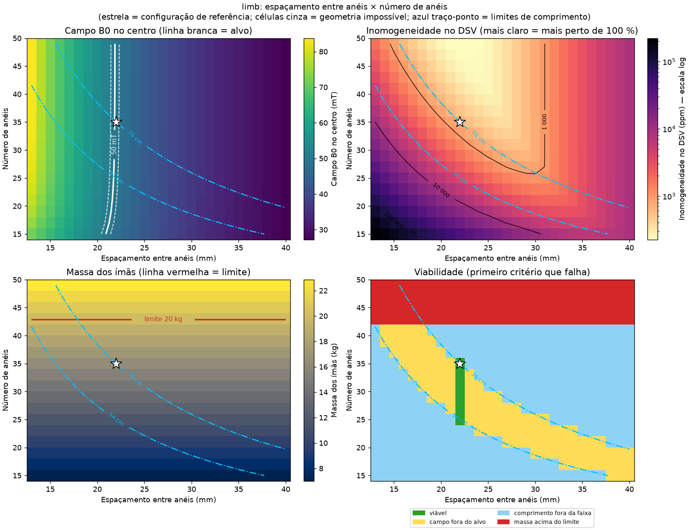

**O que varia:** espaçamento entre anéis (eixo horizontal, 13 mm a 40 mm) e número de anéis (eixo vertical, 15 a 49).

**Por que acontece:** *Espaçamento entre anéis:* Com o número de anéis fixo, espaçar mais deixa o ímã mais comprido (pontas mais longe do DSV) mas dilui o material: há menos ímãs por metro, então o campo no centro cai. O espaçamento mínimo é a aresta do cubo mais a folga axial. *Número de anéis:* Mais anéis deixam o cilindro mais comprido. Um cilindro Halbach infinito tem campo perfeitamente uniforme; as imperfeições vêm principalmente das pontas. Com mais anéis as pontas se afastam do DSV: o campo no centro cresce até saturar e a homogeneidade melhora, mas a massa cresce linearmente.

**O que os números mostram:**

* O campo no centro varia de 27,2 a 83,8 mT no plano analisado.
* 18 de 504 arranjos (3,6 %) ficam dentro de 50 ± 1 mT.
* Melhor homogeneidade do mapa: 99,978 % (225 ppm), com espaçamento entre anéis = 22 mm e número de anéis = 49 (B0 = 49,7 mT, 22,9 kg).
* **Melhor arranjo viável:** espaçamento entre anéis = 22 mm, número de anéis = 35 → B0 = 49,6 mT, homogeneidade 99,932 % (685 ppm), 16,3 kg, 76,0 cm.
* Classificação: viável 6; campo fora do alvo 102; comprimento fora da faixa 284; massa acima do limite 112.

### 6.3 Aresta do cubo × Raio livre interno (bore)

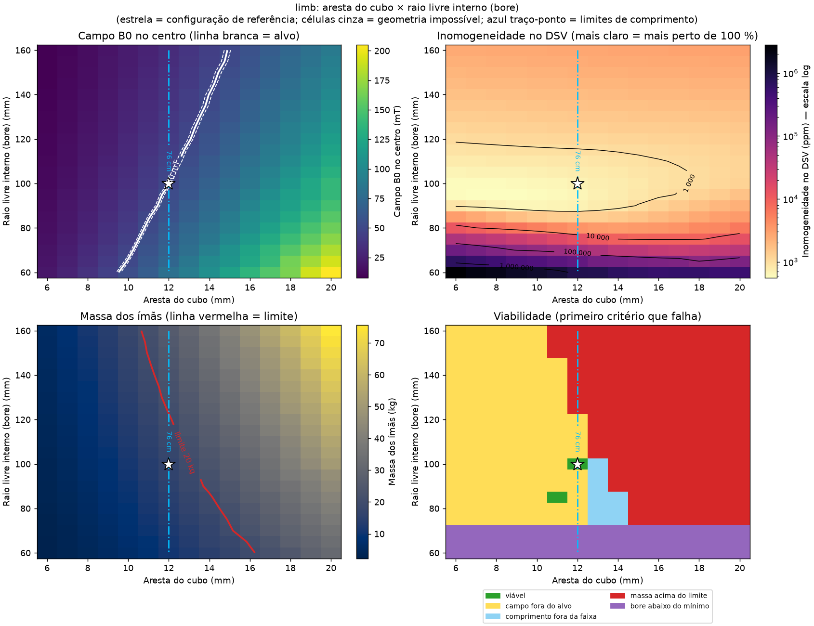

**O que varia:** aresta do cubo (eixo horizontal, 6 mm a 20 mm) e raio livre interno (bore) (eixo vertical, 60 mm a 160 mm).

**Por que acontece:** *Aresta do cubo:* Cubos maiores têm momento magnético proporcional a a³, mas cabem menos por anel (N ∝ 1/a). O campo cresce com o tamanho do ímã e a massa também. Cubos grandes também aumentam o erro do modelo de dipolo (ver DOCS/fase2_modelo_de_campo.md); aqui é usado o modelo configurado em viabilidade.toml. *Raio livre interno (bore):* Um anel maior comporta mais ímãs (N cresce com o raio), mas cada ímã fica mais longe do centro e o campo de um dipolo cai com 1/r³. O saldo é um campo que cai aproximadamente com 1/r². Em compensação, o DSV fica relativamente menor dentro do anel, o que favorece a homogeneidade no plano transversal.

**O que os números mostram:**

* O campo no centro varia de 7,7 a 205,2 mT no plano analisado.
* 6 de 315 arranjos (1,9 %) ficam dentro de 50 ± 1 mT.
* Melhor homogeneidade do mapa: 99,944 % (555 ppm), com aresta do cubo = 8 mm e raio livre interno (bore) = 95 mm (B0 = 23,3 mT, 6,6 kg).
* **Melhor arranjo viável:** aresta do cubo = 12 mm, raio livre interno (bore) = 100 mm → B0 = 49,6 mT, homogeneidade 99,932 % (685 ppm), 16,3 kg, 76,0 cm.
* Classificação: viável 2; campo fora do alvo 113; comprimento fora da faixa 9; massa acima do limite 146; bore abaixo do mínimo 45.

## 7. Compromisso entre massa e homogeneidade

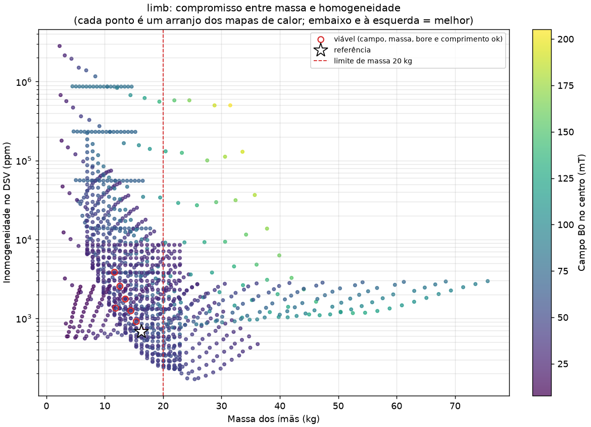

**O que mostra:** cada ponto é um arranjo dos mapas de calor, posicionado pela massa (horizontal) e pela inomogeneidade (vertical, escala log); a cor é o campo B0. Os pontos com contorno vermelho são os viáveis.

**Como ler:** o canto inferior esquerdo (leve e homogêneo) é o ideal. A borda inferior da nuvem de pontos é a **fronteira de compromisso**: para cada massa, a melhor homogeneidade que esses arranjos alcançam. Para ganhar homogeneidade além dela é preciso mudar o tipo de arranjo (por exemplo, otimizar o raio de cada anel), não só os parâmetros.

## 8. Arranjos viáveis

12 arranjos simulados atendem a todos os requisitos (homogeneidade medida no DSV de 110 mm do cenário). Como a homogeneidade é o objetivo (quanto mais perto de 100 %, melhor), eles estão ordenados por ela. Os 10 melhores:

| # | Anéis | Espaç. (mm) | Bore Ø (mm) | Camadas | Cubo (mm) | Br (T) | B0 (mT) | Homogeneidade | Inomog. (ppm) | Massa (kg) | Comprim. (cm) | Ø ext. (mm) |
|---|---|---|---|---|---|---|---|---|---|---|---|---|
| 1 | 35 | 22 | 200 | 1 | 12 | 1,30 | 49,6 | 99,932 % | 685 | 16,3 | 76,0 | 234 |
| 2 | 34 | 22 | 200 | 1 | 12 | 1,30 | 49,6 | 99,922 % | 776 | 15,9 | 73,8 | 234 |
| 3 | 33 | 22 | 200 | 1 | 12 | 1,30 | 49,6 | 99,909 % | 909 | 15,4 | 71,6 | 234 |
| 4 | 32 | 22 | 200 | 1 | 12 | 1,30 | 49,6 | 99,90 % | 1 048 | 14,9 | 69,4 | 234 |
| 5 | 31 | 22 | 200 | 1 | 12 | 1,30 | 49,5 | 99,88 % | 1 245 | 14,5 | 67,2 | 234 |
| 6 | 35 | 22 | 170 | 1 | 11 | 1,30 | 49,4 | 99,87 % | 1 343 | 11,9 | 75,9 | 201 |
| 7 | 30 | 22 | 200 | 1 | 12 | 1,30 | 49,5 | 99,85 % | 1 458 | 14,0 | 65,0 | 234 |
| 8 | 29 | 22 | 200 | 1 | 12 | 1,30 | 49,5 | 99,82 % | 1 753 | 13,5 | 62,8 | 234 |
| 9 | 28 | 22 | 200 | 1 | 12 | 1,30 | 49,5 | 99,79 % | 2 090 | 13,1 | 60,6 | 234 |
| 10 | 27 | 22 | 200 | 1 | 12 | 1,30 | 49,4 | 99,75 % | 2 550 | 12,6 | 58,4 | 234 |

## 9. Limitações e próximos passos

* **Anéis iguais:** a homogeneidade absoluta é pessimista (ver seção 1). Os
  valores servem para comparar tendências; o número final vem da otimização
  dos raios.
* **Só ímãs:** a massa não inclui a estrutura de suporte, as bobinas nem a
  blindagem.
* **Ímãs ideais:** todos os cubos com o mesmo Br e posição perfeita. Na
  prática, Br varia ~±1-2 % entre peças e há erro de montagem. Isso piora a
  homogeneidade e normalmente é corrigido com shimming.
* **Temperatura:** o NdFeB perde ~0,1 %/°C de Br. O campo (e a frequência de
  Larmor) varia com a temperatura, mas a homogeneidade em ppm não.
* **Homogeneidade como objetivo:** a homogeneidade não é um corte de
  viabilidade; os arranjos viáveis são ordenados por ela (o mais perto de
  100 % vence). Para exigir um valor mínimo, defina `ppm_maximo` no
  `viabilidade.toml` (ex.: 99,9 % = 1000 ppm).
